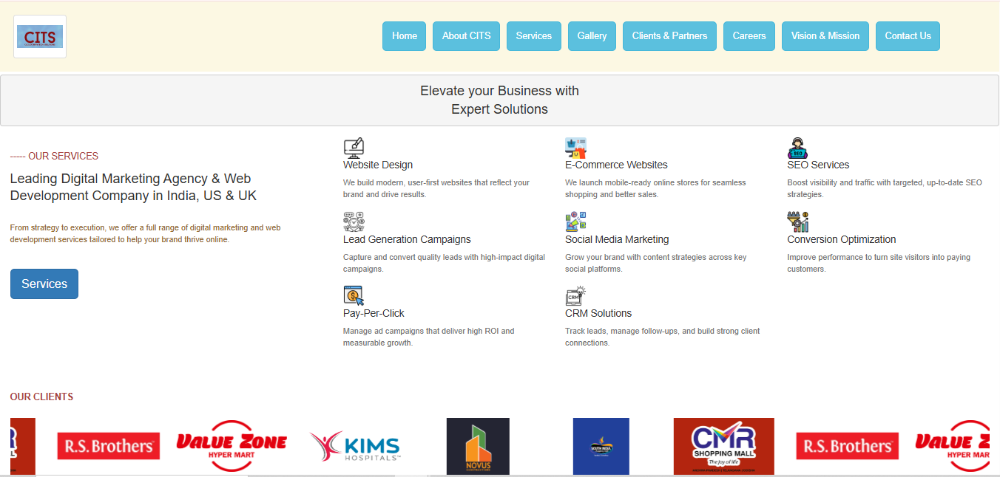
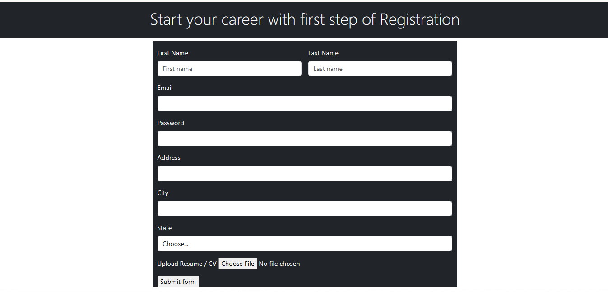

Project Update – Dynamic Website Workflow Module

Current Progress

I have successfully developed the Home Page and Career Page by referring to the Dynamic Website Workflow Module shared earlier.

Completed Tasks

Designed and developed the Home Page.

Created the Career Page.

Implemented the basic website structure and UI.

Followed the reference workflow and requirements.

Current Status

The Home Page and Career Page have been completed. I will continue working on the remaining modules and functionalities as per the provided workflo.

# Home Page ##
this is my home_page which have been completed as for now

# Career Page##
this is my career_page which have been completed as for now
